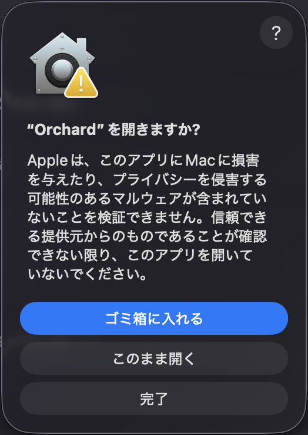

# First installation

Orchard 0.4 (build12) supports Apple Silicon/macOS26+. It is ad-hoc signed and not notarized by Apple. An app-specific exception is not a safety guarantee.

## Download and expand once

1. Download `Orchard-0.4-build12-release.zip` and `SHA256SUMS` from the project's GitHub Release. Check the filename, trusted source and [checksum](VERIFY.md).
2. Expand that ZIP once. On a Mac, the usual action is to double-click the ZIP.
3. Open the resulting `Orchard` folder. It contains exactly **Orchard.app** and **はじめに・説明書** (guides and notices). Open the app to use Orchard, or the other folder to read. No second application archive is needed.

```text
Orchard/
├── Orchard.app
└── はじめに・説明書/
    ├── 00_はじめに.md
    ├── README.ja.md / README.md
    ├── INSTALL.ja.md / INSTALL.md
    ├── GUIDE.ja.md / GUIDE.md
    ├── LICENSE / THIRD_PARTY_NOTICES.md
    ├── images/
    ├── examples/
    ├── licenses/
    └── src/  （ほかの既存文書も保持 / other existing documents retained）
```

The README, installation guide, images, examples, source and license materials are inside **はじめに・説明書**. From this guide, go back one folder to open **Orchard.app**. Keep the license materials with it. Separate Python or Homebrew installation is unnecessary.

## Open Orchard

1. Double-click **Orchard.app**. Avoid running multiple Orchard versions monitoring simultaneously.
2. If the warning says Apple cannot verify the developer or check the app for malware, first check its source and integrity, then go to System Settings → Privacy & Security.
3. Find the blocked Orchard entry and choose **Open Anyway**, labeled 「このまま開く」 in Japanese.


4. Confirm the next app-specific prompt using **Open Anyway** / 「このまま開く」. If macOS requests authentication, the user performs it in the OS dialog; do not send passwords to support.



These are two crops from one supplied Japanese macOS screenshot: the blocked entry and the confirmation dialog. Original pixels are retained; surrounding information and image metadata are removed. They do not show click completion or post-launch results. Wording can vary with OS version and language. [Apple's instructions](https://support.apple.com/en-us/102445).

There is no need to disable Gatekeeper globally or remove quarantine. Stop on damaged-app, will-damage-your-computer, known-malware or administrator-policy warnings and use [support](SUPPORT.md).

## First inspection

Choose 「ZIPを選んで照合」 and select `Orchard/はじめに・説明書/examples/benign-notes.zip`, then choose 「このZIPを照合」. Read the reference snapshot and results; see the [guide](GUIDE.md). Nonmatches and rule non-detection do not establish safety.

Images illustrate build10's macOS warnings. Build12 registration adoption, manual monitoring and change review were observed on a Mac with disposable r2-equivalent state. This does not establish Internet installation, another-Mac operation or runtime worker Sandbox enforcement. See [status](RELEASE_NOTES.md). Read [update instructions](UPDATE.md) first if you already have a registration.
